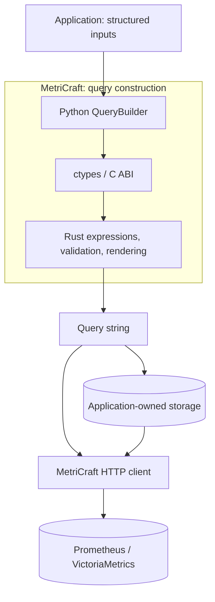

# Architecture

## Scope and repository

MetriCraft is a query construction SDK and a Prometheus/VictoriaMetrics HTTP client. Query
languages are limited to PromQL and MetricsQL. There is no SQL/Flux abstraction,
server, dashboard or storage service in the product.

Rust and Python stay in one repository so AST, ABI, bindings and tests can change
in the same commit.



The source lives in `crates/metricraft-core/`, `crates/metricraft-ffi/` and `python/metricraft/`; application examples are in `docs/examples/`.

## One builder, two modes

`metricraft.QueryBuilder` is the single public builder. Stateless operation modules
provide the fluent methods; `_expression.py` owns native handles and `_native.py`
binds ctypes. Operations depend on the native boundary, not the HTTP client.

Create expressions without server configuration. `build("promql")` and
`build("metricsql")` return query strings; MetricsQL is the default. Choose the
mode explicitly when saving text.

`@vm_only` marks MetricsQL-only methods and `@prom_only` marks PromQL-only methods;
the Rust node carries the actual requirement
and every nested node is checked during build. Function signatures also carry
requirements: `rate(selector)` uses MetricsQL's implicit range, while
`rate(selector[5m])` is accepted in both modes. This is one method with different
call forms, not two builders.

The pinned MetricsQL parser does not implement PromQL's `histogram_count` or
`histogram_sum`. Those methods are marked `@prom_only` and the core rejects them
in MetricsQL mode, including through the generic `function()` entry point.
Metadata is checked in Rust rather than trusting decorators in Python.

## Aggregation and grouping

Plain aggregation is valid in both dialects. Grouping is a separate, exclusive
operation, not two optional parameters on every aggregation method:

```python
from metricraft import QueryBuilder as Q

aggregate = Q.from_metric("http_requests_total").rate("5m").sum()
total = aggregate.build("promql")
per_job = aggregate.by("job").build("promql")
per_other_labels = aggregate.without("instance").build("metricsql")
```

`sum(by=..., without=...)` is not accepted. Once an aggregation is grouped,
another `by()`/`without()` call is rejected by Rust, including repeated calls of
the same kind. Derive alternatives from the ungrouped expression. Empty `by()`
and `without()` remain distinct: the former groups by no labels; the latter
excludes no labels from the grouping key. Parameterized aggregations use the same
shape, for example `topk(3).by("job")`.

## Functional core and ownership

The core uses private nodes behind `Arc`. Every transformation returns a new
expression and shares existing immutable children. No mutation of public expressions,
parent links, mutable AST registry, or Python copy of the AST is used by this path.

Selectors share a persistent matcher chain and an immutable metric name. Binary
modifiers share their label lists. The source metric is chosen only with
`from_metric()` and stays fixed for that expression.
Reusable selection logic belongs in a pure function over immutable application
parameters. MetricsQL `alias()` is a query transform of result names, not a way to
change the original source selector.

The C ABI borrows child pointers during a call and returns an owning opaque pointer.
Rust retains shared children independently of Python objects. Python finalizers free
each owner; freeing an intermediate Python expression does not invalidate its parents.
Client-only imports do not load the native library. Unsafe C callers must respect
pointer validity and release each returned expression exactly once.

Validation and rendering live in the core. Python handles argument adaptation and
convenience methods; the ABI handles strings, errors and lifetimes. No Python renderer
is used as a fallback. The native library exposes only the immutable
expression ABI. Python checks `mc_abi_version()` before binding expression functions
and gives a rebuild/reinstall error for an incompatible library.

Constructor and build failures use owned, thread-local error snapshots. Recoverable
Rust panics are caught at those ABI boundaries. This does not make invalid C pointers,
allocation failure or recursive stack exhaustion recoverable; complexity and memory
stress behavior is handled separately. Rendering and last-owner destruction now
use iterative traversal, including persistent matcher chains.

Each node stores two size counters rather than cached query text. `build()` checks
the expanded text size before allocation, with defaults of 1 MiB UTF-8 output and
100,000 expanded node occurrences (including matchers). These can be overridden
per call with positive `max_output_bytes` and `max_expanded_nodes` values. Reusing
a subtree does not eliminate its repeated occurrences in the output string.
The budgets are not a process-wide memory quota. See [memory behavior](memory.md).

## Implemented surface

The [language support guide](language-support.md) defines the pinned catalogs,
syntax and experimental feature flags. The core covers:

- **Selection and time:** named/unnamed selectors, label matchers, ranges,
  subqueries, offsets and timestamps.
- **Composition:** arithmetic, comparison, set operations, vector matching,
  aggregation/grouping and the typed function catalog.
- **Extensions:** dialect-specific functions, MetricsQL scoped templates and
  Prometheus experimental syntax with explicit opt-in.

Fluent methods and `Q.function(name, *args)` use the same native signatures in
[`functions.rs`](../crates/metricraft-core/src/expression/functions.rs) and the
[label catalog](../crates/metricraft-core/src/expression/functions/labels.rs).
Strings stay literals. Repeated `.where_*()` calls add simultaneous constraints,
including on the same label, and never replace an earlier application restriction.

Experimental build flags apply only to that build and require matching server
support. They never bypass type or dialect checks. The independent compatibility
workflow tests discovered capabilities against upstream parsers and real backends;
see [backend verification](backend-validation.md) for evidence and limitations.

Regression tests and benchmarks exercise the public immutable builder directly.

## Client and packaging

There is one distribution and namespace: `metricraft`. Endpoint configurations
`PrometheusConfig`, `VMSingleConfig` and `VMClusterConfig` select HTTP routing;
they do not select the builder's query mode. `DatabaseClient(config)` constructs
the concrete client directly. No entry points, plugin discovery, factory metaclass
or installation of a second package is required.

Sync/async queries, ranges, metadata, VictoriaMetrics ingestion, tenant routing
and result models share that client. Prefer explicit configuration; the optional
[named registry](models.md#optional-configuration-registry) supports multiple
instances. Ambiguous names fail before transport allocation. `DBType` identifies
HTTP backends, while `QueryMode` identifies query languages.

`DatabaseClient`, `SyncHTTPClient` and `AsyncHTTPClient` are concrete classes without
provider base classes. Custom transports are injected through `HttpClientOptions`
as ordinary objects implementing the required `get`/`post` methods. Factories remain
available for applications that need to create transports from connection settings.
The client composes a transport owner for idempotent cleanup rather than inheriting
lifecycle hooks. Use `with` or explicit `close()` for synchronous use; use `async with`
or `aclose()` for async-only transports. Garbage collection provides best-effort
synchronous cleanup. The default async wrapper borrows the client's sync transport,
so the owner closes it once; a standalone wrapper also leaves an injected transport
or executor under its caller's ownership.

When a client receives a `QueryBuilder`, it builds using its configured dialect,
including selectors supplied to metadata APIs. Unsupported SDK expressions fail
before the HTTP request. Saved strings and external text producers retain their
own validation contract; the client does not parse or sanitize their output.

`MetricsQueryResult` and `MetricsInsertData` are concrete frozen dataclasses.
Use these concrete result types and transport injection. Configuration inheritance
expresses three endpoint layouts, and metadata result subclasses share response parsing.

The native library is bundled under `metricraft/native/` by GitHub Actions.
The C ABI uses no CPython extension API, so wheels are tagged `py3-none-<platform>`.
The release gate checks source identity, wheel integrity and installed behavior.
The sdist includes the Python SDK, Rust sources and Cargo lockfile for standalone builds.
See [the workflow guide](../CONTRIBUTING.md#github-actions) for targets and triggers.

## Performance and next work

Public query validation raises `TypeError` or `ValueError`; native loading failures
raise `RuntimeError`.
The public exception package contains `MetriCraftError` and its HTTP subclasses
`MCHTTPError`, `TimeoutError` and `ConnectionError`. The public enum package contains `DBType`.

The structure avoids Python AST traversal and full-tree cloning during
composition. [Local microbenchmarks](../benchmarks/README.md) measure construction,
rendering, release and reuse in the current Python facade and pure Rust. The unified
suite also measures synthetic configurable-monitoring workloads and concurrent
memory behavior. These substitute for the unavailable original trace, and do not
establish production application or HTTP latency.

HTTP transport stays in Python. See [language support](language-support.md) for
the supported baseline and [the contribution guide](../CONTRIBUTING.md#github-actions)
for package validation and release checks.
