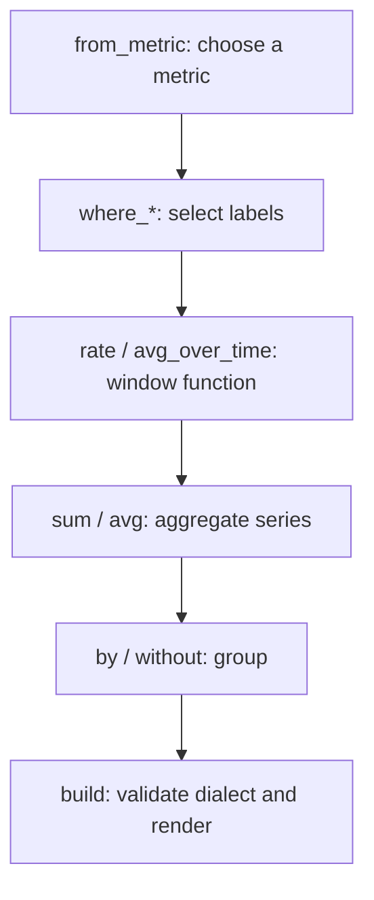

# Build queries



The request-rate example below follows this pipeline. Each step returns a new expression.


## Start with a value

```python
from metricraft import QueryBuilder as Q

requests = Q.from_metric("http_requests_total")
selected = requests.where_eq("job", "api").where_regex("status", "5..")
```

Factories also construct scalars (`Q.from_scalar(1)`), strings
(`Q.from_string("api")`) and unnamed selectors (`Q.from_labels(job="api")`).
There is no metric-name setter. Start a new expression to select another metric.

Use `.where_eq()`, `.where_ne()`, `.where_regex()` and `.where_not_regex()` to
add matchers. Values are escaped as query literals; regex methods intentionally
preserve regex meaning. Repeated filters are conjunctive, not replacements.

## Roll up, then aggregate

```python
rate = selected.rate("5m")
by_job = rate.sum().by("job")
total = rate.sum()
without_instance = rate.sum().without("instance")
```

Ungrouped aggregation is valid in both PromQL and MetricsQL. `.by()` and
`.without()` are mutually exclusive grouping choices on an aggregate. Do not
pass both; the native validator rejects conflicting forms.

## Compose arithmetic and matching

```python
all_requests = requests.rate("5m").sum().by("job")
failures = requests.where_regex("status", "5..").rate("5m").sum().by("job")
fraction = (failures / all_requests).on("job")
text = fraction.build("promql")
```

Python arithmetic and comparison operators construct expressions. Use explicit
parentheses for complex combinations. Python `and`, `or` and `if expression`
request a truth value and are not query operations; use `.and_()` / `.or_()` for
set operations. Matching uses `.on()` or `.ignoring()`, with
`.group_left()` / `.group_right()` where the language allows it.

## Use the function catalog

Fluent methods cover the catalog, with a generic entry point for explicit calls:

```python
rounded = Q.function("round", Q.from_metric("temperature_celsius"), 0.1)
text = rounded.build("promql")
```

Arguments remain typed values. `Q.function("rate", "requests[5m]")` does not
parse the string into an expression. Use `requests.rate("5m")` or pass a range
expression. Both fluent and generic calls use the Rust signature catalog.

## Render within a budget

```python
text = by_job.build("promql", max_output_bytes=64_000, max_expanded_nodes=10_000)
```

Defaults are 1 MiB of output and 100,000 expanded node occurrences. Shared nodes
count each time they appear in output. These limits bound rendering, not retained
application roots, server query cost or server-side template expansion.

For subqueries, offsets, scoped MetricsQL templates and experimental Prometheus
forms, see [language support](language-support.md) and the
[extension example](examples/03_language_extensions/README.md).
