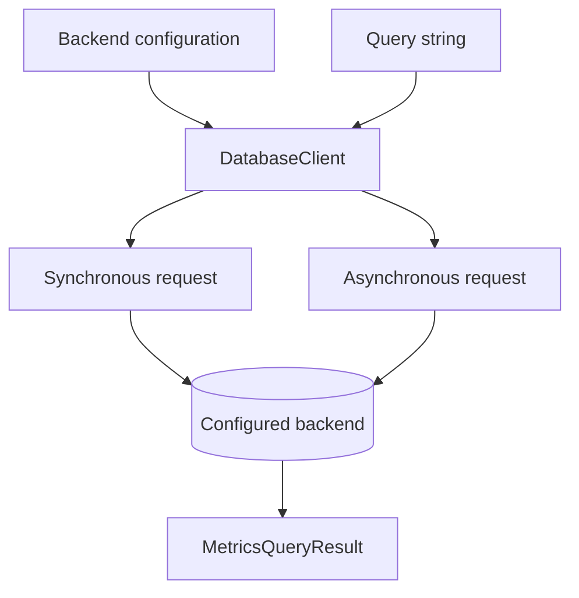
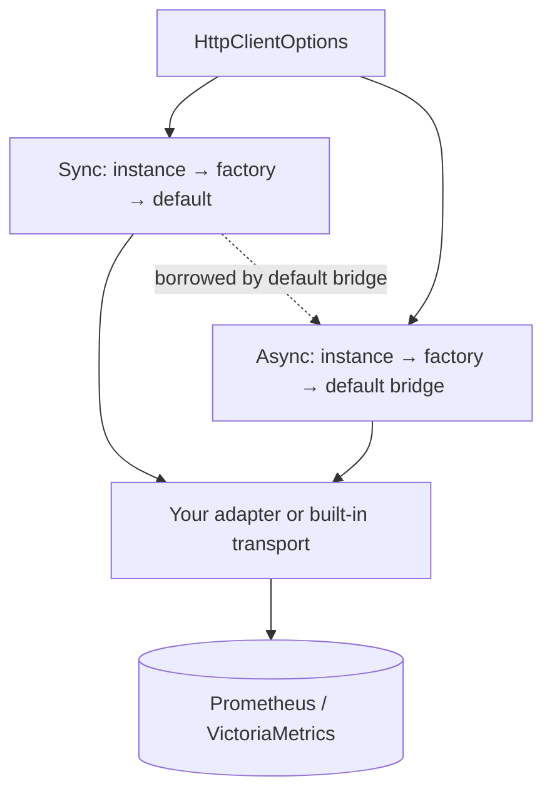

# Query your backend

`DatabaseClient` handles synchronous and asynchronous HTTP calls. It can execute
saved query strings without loading the Rust builder library.



## Choose an endpoint

```python
from metricraft import (
    DatabaseClient, HttpClientOptions, PrometheusConfig,
    VMSingleConfig, VMClusterConfig,
)

prometheus = PrometheusConfig("http://localhost:9090")
single = VMSingleConfig("http://localhost:8428")
cluster = VMClusterConfig(
    vminsert_url="http://localhost:8480",
    vmselect_url="http://localhost:8481",
    vmstorage_url="http://localhost:8482",
    account_id=0,
)
```

Cluster configuration adds tenant prefixes to query and insert endpoints.
Per-request `account_id` overrides only apply to `VMClusterConfig`. Prometheus
does not support the client's VictoriaMetrics ingestion API.

## Instant and range queries

```python
with DatabaseClient(prometheus) as client:
    instant = client.query("up")
    history = client.query_range(
        "up",
        start="2026-01-01T00:00:00Z",
        end="2026-01-01T01:00:00Z",
        step="1m",
    )
    print(instant.is_success, history.is_success)
```

These examples require a running server. Range results depend on data available
at the requested times. Prefer explicit bounds when reproducing an incident or
comparing results. Query times accept Unix timestamps and RFC3339 strings;
VictoriaMetrics additionally supports relative time strings.

## Asynchronous calls

```python
import asyncio
from metricraft import DatabaseClient, PrometheusConfig

async def read():
    async with DatabaseClient(PrometheusConfig("http://localhost:9090")) as client:
        result = await client.query_async("up")
        print(result.is_success)

asyncio.run(read())
```

Use `.query_range_async()` for ranges. The asynchronous context manager awaits
transport cleanup. If managing lifetime yourself, call `await client.aclose()`.

## Configure transport behavior

```python
options = HttpClientOptions(timeout=(5.0, 30.0))
config = PrometheusConfig("http://localhost:9090", http_options=options)
```

The tuple specifies connection and read timeouts in seconds. The query method's
`timeout="30s"` is a separate server query timeout. `HttpClientOptions` also
supports headers and injected sync/async transports. Keep credentials in your
application's secret configuration, not persisted query strings.

## Replace the HTTP transport

The HTTP layer is a public extension point. Wrap your application's HTTP pool,
authentication, tracing or retry policy in an adapter and inject it through
`HttpClientOptions`. The four contracts are importable from `metricraft`:

| Slot | Public contract | Selection |
| --- | --- | --- |
| `client` | `SyncHTTPTransport` | Use this instance for synchronous calls. |
| `async_client` | `AsyncHTTPTransport` | Use this instance for asynchronous calls. |
| `client_factory` | `SyncHTTPTransportFactory` | Construct the sync transport if `client` is absent. |
| `async_client_factory` | `AsyncHTTPTransportFactory` | Construct the async transport if `async_client` is absent. |



### Implement an adapter

These are structural `Protocol` contracts: inheritance and registration are not
required. Both transports provide `get()` and `post()` with the signatures below;
an async adapter uses `async def` for both. Type checkers verify the named arguments
and decoded `HTTPResponse` dictionary. Nested JSON values have type `object`, so
narrow them before accessing them. This wrapper uses the built-in transport; replace
its internals with your HTTP library while preserving the same contract.

```python
from typing import Optional
from metricraft import DatabaseClient, HttpClientOptions, PrometheusConfig, SyncHTTPTransport
from metricraft.client import SyncHTTPClient
from metricraft.transports import HTTPBody, HTTPHeaders, HTTPParams, HTTPResponse, HTTPTimeout

class AppTransport:
    def __init__(self, inner: SyncHTTPClient):
        self.inner = inner

    def get(self, url: str, params: Optional[HTTPParams] = None, *,
            headers: Optional[HTTPHeaders] = None,
            timeout: Optional[HTTPTimeout] = None) -> HTTPResponse:
        return self.inner.get(url, params, headers=headers, timeout=timeout)

    def post(self, url: str, data: HTTPBody = None,
             params: Optional[HTTPParams] = None, *,
             headers: Optional[HTTPHeaders] = None,
             timeout: Optional[HTTPTimeout] = None,
             content_type: Optional[str] = None) -> HTTPResponse:
        return self.inner.post(url, data, params, headers=headers,
                               timeout=timeout, content_type=content_type)

    def get_text(self, url: str) -> str:
        return self.inner.get_text(url)

    def close(self) -> None:
        self.inner.close()

transport: SyncHTTPTransport = AppTransport(SyncHTTPClient(timeout=(5, 30)))
config = PrometheusConfig(
    "http://localhost:9090", http_options=HttpClientOptions(client=transport),
)
with DatabaseClient(config) as client:
    result = client.query("up")
```

The query requires a running server. A requests/httpx response object is not the
contract: your adapter must decode the backend JSON object before returning it.
For ingestion, `post()` must also accept a text or bytes body. Map transport failures
to `MCHTTPError`, `TimeoutError` or `ConnectionError` from `metricraft` if you want
applications to handle the same exception types as the built-in transport.

`get_text(url) -> str` is optional and supports plain-text health endpoints. Without
it, health checks fall back to `get()`. A generic `request()` method is optional;
the default async bridge uses it when present, otherwise it delegates to `get()`
and `post()`. Implement the full signatures even if your application currently only
queries, so the adapter also works with ingestion and the async bridge.

### Construct transports with factories

Factories run during `DatabaseClient` construction. Both receive keyword-only
`http_options` (normalized settings) and `connection_info` (backend configuration).
The async factory also receives the selected `sync_client`; it is a regular
function returning an async transport, not a coroutine factory. Building on the
adapter above:

```python
from typing import Mapping
from metricraft import AsyncHTTPTransport, SyncHTTPTransport
from metricraft.client import AsyncHTTPClient

def make_sync(*, http_options: Mapping[str, object],
              connection_info: Mapping[str, object]) -> SyncHTTPTransport:
    settings = HttpClientOptions.from_mapping(http_options)
    return AppTransport(SyncHTTPClient(
        timeout=settings.timeout, default_headers=settings.default_headers,
    ))

def make_async(*, http_options: Mapping[str, object],
               connection_info: Mapping[str, object],
               sync_client: SyncHTTPTransport) -> AsyncHTTPTransport:
    return AsyncHTTPClient(sync_client=sync_client)

options = HttpClientOptions(
    timeout=(5, 30), default_headers={"X-Application": "dashboard"},
    client_factory=make_sync, async_client_factory=make_async,
)
config = PrometheusConfig("http://localhost:9090", http_options=options)
```

Pass `config` to `DatabaseClient` and use `query()` or `await query_async()` as usual.
Without an async instance or factory, the SDK bridges the selected sync transport
through a thread pool. Supply `async_client` or `async_client_factory` to use native
async I/O. Injected transports own their HTTP policy: settings such as headers,
timeouts, authentication and retries are not automatically applied to an existing
instance. A factory can read and apply them explicitly.

### Own transport lifetime

`DatabaseClient` owns cleanup of its selected transports, including injected
instances. A sync transport can supply `close()`; an async transport can supply
`aclose()`, `close()`, or both. `with` calls synchronous cleanup; `async with` awaits
`aclose()` when available and then closes the sync transport. Use `async with` or
`await client.aclose()` for adapters that require asynchronous cleanup.

The built-in async bridge borrows its sync transport and external executor; it
does not close those borrowed resources. The owning `DatabaseClient` closes its
sync transport. If your adapter wraps a pool shared by the application, make its
cleanup hook preserve that pool and let the application close it. Finish in-flight
requests before closing. Shared adapters must support concurrent calls, including
when using free-threaded Python or the default async bridge.

## Handle results and failures

`MetricsQueryResult` exposes `is_success`, result type, data and server errors.
Transport failures use the SDK's `MCHTTPError`, `TimeoutError` and
`ConnectionError` exceptions, all available from `metricraft`.
Metadata methods include `series()`, `labels()` and `label_values()`, with
asynchronous counterparts.

The client sends supplied strings; it does not parse or sanitize stored queries.
Applications own authorization, validation and storage. For a runnable example
that needs no server, see [save now, query later](examples/02_saved_query/README.md).
