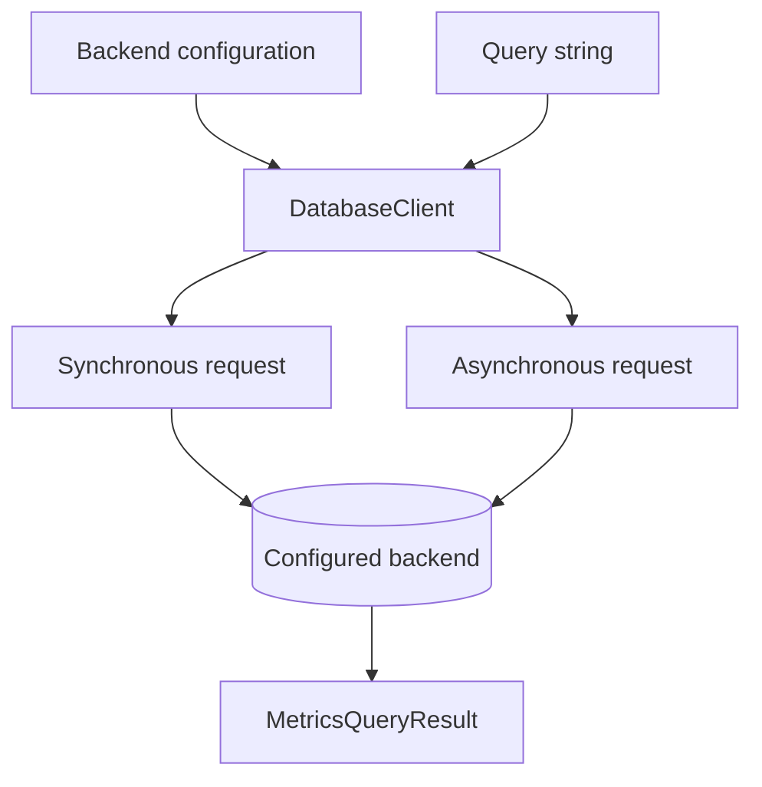

# Query your backend

`DatabaseClient` handles synchronous and asynchronous HTTP calls. It can execute
saved query strings without loading the Rust builder library.



## Choose an endpoint

```python
from metricraft import (
    DatabaseClient, HttpClientOptions, PrometheusConfig,
    VMSingleConfig, VMClusterConfig,
)

prometheus = PrometheusConfig("http://localhost:9090")
single = VMSingleConfig("http://localhost:8428")
cluster = VMClusterConfig(
    vminsert_url="http://localhost:8480",
    vmselect_url="http://localhost:8481",
    vmstorage_url="http://localhost:8482",
    account_id=0,
)
```

Cluster configuration adds tenant prefixes to query and insert endpoints.
Per-request `account_id` overrides only apply to `VMClusterConfig`. Prometheus
does not support the client's VictoriaMetrics ingestion API.

## Instant and range queries

```python
with DatabaseClient(prometheus) as client:
    instant = client.query("up")
    history = client.query_range(
        "up",
        start="2026-01-01T00:00:00Z",
        end="2026-01-01T01:00:00Z",
        step="1m",
    )
    print(instant.is_success, history.is_success)
```

These examples require a running server. Range results depend on data available
at the requested times. Prefer explicit bounds when reproducing an incident or
comparing results. Query times accept Unix timestamps and RFC3339 strings;
VictoriaMetrics additionally supports relative time strings.

## Asynchronous calls

```python
import asyncio
from metricraft import DatabaseClient, PrometheusConfig

async def read():
    async with DatabaseClient(PrometheusConfig("http://localhost:9090")) as client:
        result = await client.query_async("up")
        print(result.is_success)

asyncio.run(read())
```

Use `.query_range_async()` for ranges. The asynchronous context manager awaits
transport cleanup. If managing lifetime yourself, call `await client.aclose()`.

## Configure transport behavior

```python
options = HttpClientOptions(timeout=(5.0, 30.0))
config = PrometheusConfig("http://localhost:9090", http_options=options)
```

The tuple specifies connection and read timeouts in seconds. The query method's
`timeout="30s"` is a separate server query timeout. `HttpClientOptions` also
supports headers and injected sync/async transports. Keep credentials in your
application's secret configuration, not persisted query strings.

## Handle results and failures

`MetricsQueryResult` exposes `is_success`, result type, data and server errors.
Transport failures use the SDK's `MCHTTPError`, `TimeoutError` and
`ConnectionError` exceptions, all available from `metricraft`.
Metadata methods include `series()`, `labels()` and `label_values()`, with
asynchronous counterparts.

The client sends supplied strings; it does not parse or sanitize stored queries.
Applications own authorization, validation and storage. For a runnable example
that needs no server, see [save now, query later](examples/02_saved_query/README.md).
