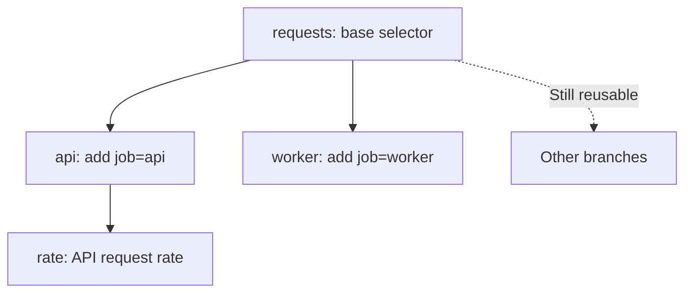

# A few useful ideas

## Expressions are values

An expression describes a query. Creating or combining one does not contact a
server. Each operation returns a new value; an existing expression cannot be
renamed, edited or consumed by a later operation.

```python
from metricraft import QueryBuilder as Q

requests = Q.from_metric("http_requests_total")
api = requests.where_eq("job", "api")
worker = requests.where_eq("job", "worker")
```



Rust nodes share immutable subexpressions through reference counting. A branch
does not deep-copy the whole tree. Retaining many distinct roots still consumes
memory: sharing reduces duplication, but is not a limit on application-owned
queries. See [sharing and memory](memory.md).

## Build chooses the dialect

There is one `QueryBuilder`. `.build("promql")` and `.build("metricsql")`
validate the entire expression for the chosen language and render a string.
MetricsQL-only forms fail when built as PromQL; PromQL-only forms fail when built
as MetricsQL. The API reference labels both `vm_only` and `prom_only` methods.
Experimental Prometheus forms
need explicit build flags and matching server configuration.

The default build mode is MetricsQL. Building the same supported expression for
both languages does not imply identical numerical results from their servers.
See the [language contract](language-support.md) for exact baselines and limits.

## Strings are data during construction

Pass label values to methods such as `.where_eq()`. The builder escapes them as
literals. Pass actual expressions to expression arguments. A string passed to
`Q.function()` is a string literal, never an embedded query fragment.

The application still chooses which metrics, labels, operations and regexes a
user is permitted to request. A syntactically safe query can be expensive or
access data a particular user should not see.

## Persistence belongs to your application

The output of `.build()` is an ordinary string. Save it in a database, YAML, XML
or any other format you own, using that format's normal serializer. Load it later
and give it to `DatabaseClient`.

MetriCraft does not store queries, validate arbitrary stored query text, or
provide access control. Its builder protects structured construction. Its client
executes the supplied text. The [saved-query example](examples/02_saved_query/README.md)
shows this boundary with SQLite and an offline transport.

## Evaluation belongs to the backend

MetriCraft constructs syntax and handles HTTP requests. It does not evaluate a
query or implement a time-series database. Backend retention, staleness, query
cost and numerical behavior remain server concerns.
