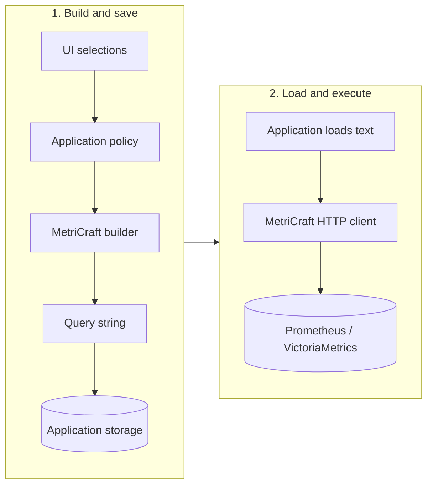

# Configurable query contract

Turn application selections into a query, then store and execute it on your terms.
Construction needs no database connection; execution only needs query text.

The builder produces query text. Your application stores and loads it; the backend evaluates it. The two stages can run separately.

- **Your application:** allowed metrics, labels, operations, authorization and cost limits, plus storage in YAML/XML/a database. Derive changed selections from the appropriate base expression.
- **The builder:** expression structure, names, durations and function signatures; escaping label values and string arguments. Repeated matchers are conjunctive and cannot overwrite an earlier tenant restriction. Regexes retain their meaning and cost.
- **The client:** sync/async queries, metadata, ingestion, custom transports, result models and cluster routing. Build and save text in the intended dialect; executing loaded text does not select a dialect or revalidate it.

The construction guarantee applies to structured inputs. There is no raw-expression
insertion API, and the client does not parse, sanitize or repair arbitrary query
strings. Applications own subsequent edits, storage integrity, authorization and
regex/query cost policy.

See the [structured selection example](examples/01_configurable_query/README.md)
and [saved query example](examples/02_saved_query/README.md).
