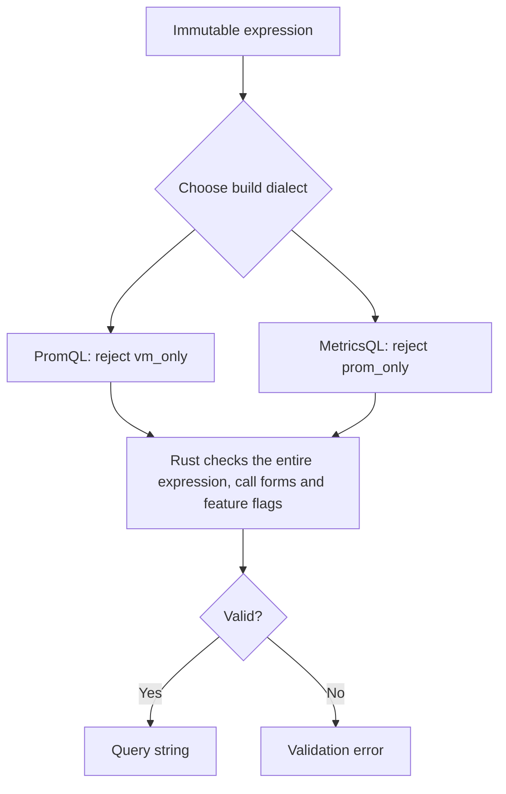

# Language support

The development branch targets Prometheus **3.16.0** and VictoriaMetrics
**1.156.0**, whose MetricsQL parser dependency is **v0.87.6**. The catalog covers
all 91 PromQL functions and 14 aggregates, and all 195 documented MetricsQL
functions and 37 aggregates in this baseline. Use fluent methods or
`Q.function(name, *args)`; both use the same native signature checks.

These are the pinned verification targets, not an unrestricted `>=` version
promise. The published **0.3.0** package targets Prometheus 3.15.0 /
VictoriaMetrics 1.153.0; the changes below are unreleased. Older servers support
the subset of calls available in their own version. In particular:

| Capability | Server version and opt-in |
| --- | --- |
| `integral()` | Prometheus 3.16+, experimental functions |
| `anchored` / `smoothed` | Stable in Prometheus 3.16; 3.15 needs the server's extended-range feature flag |
| Unquoted Unicode/dotted input names | Prometheus 3.16+, `promql-unquoted-utf8-names` when parsing; generated names remain quoted |

The 2026-11-11 audit found no function or aggregate catalog additions between
VictoriaMetrics 1.153.0 and 1.156.0. Backend fixes remain the server's responsibility.

Support is checked in both directions. The API reference marks MetricsQL-only
methods as `vm_only` and PromQL-only methods as `prom_only`. For example,
`histogram_count()` and `histogram_sum()` require PromQL in this baseline and
are rejected in MetricsQL, including through `Q.function()` or nested expressions.
Some shared methods also have dialect-specific argument forms; a method without
an exclusive badge is not a guarantee that every call form works in both languages.

This is a query builder and HTTP client with an unreleased
[bounded query parser and immutable AST editing API](query-parsing.md).
Backend calculations, storage, staleness and native-histogram data handling
belong to the selected server. Existing query strings can go directly to the client.
Numeric/duration input formats are normalized; generated text has no comments or
trailing commas. No raw-expression insertion API exists.



## Construction

- Selectors support UTF-8 metric/label names, escaped values, repeated conjunctive
  filters, unnamed selectors and regex-only selectors. PromQL rejects selectors
  without a metric or a filter that excludes empty label values. MetricsQL allows
  empty selectors and `or_selector()` alternatives. Names must be nonempty and
  contain no control characters. Regex values retain their intentional RE2 meaning.
- Arithmetic, comparisons, set operators, `.bool()`, `.on()`/`.ignoring()`,
  `.group_left()`/`.group_right()`, ranges, subqueries, offsets and timestamps are
  structured operations. Aggregation grouping uses exclusive `.by()`/`.without()`.
- MetricsQL adds scalar/vector/range implicit conversions, variadic aggregates,
  fractional/interval durations, expression timestamps, `.eq_any()`/`.ne_all()`,
  `.group_left_all(prefix=...)`, `.group_right_all(prefix=...)`, `.limit()`,
  `default`/`if`/`ifnot`, and `.keep_metric_names()`.
- `Q.from_duration("1h30m")` creates a scalar in seconds;
  `Q.from_duration("2i")` uses query-time `step()`.
  `Q.from_numeric_literal("1_000Ki")` normalizes numeric suffixes.
- MetricsQL `Q.reference()`, `Q.template()`, `Q.template_call()` and `.with_()`
  provide lexical bindings. Definitions see earlier bindings; parameters and inner
  scopes shadow outer names. References are checked during build. String references
  use `kind="string"` and can compose escaped selector values with `+`.

Every derivation returns a new expression sharing Rust nodes. There is no source
metric setter, mutable AST, global symbol registry or Python AST copy.

## Prometheus feature flags

Experimental functions require `experimental_functions=True`. Experimental syntax
requires its feature name in `features`, and the server must enable the same flags:

```python
from metricraft import QueryBuilder as Q

a, b = Q.from_metric("a"), Q.from_metric("b")
text = (a + b).fill(0).build(
    "promql", features=("promql-binop-fill-modifiers",))

text = a.range(Q.step().max_of(60) * 2).rate().build(
    "promql", features=("promql-duration-expr",))

text = a.range("5m").anchored().rate().build("promql")
```

Duration expressions allow numbers, arithmetic, `step()`, `range()` (the
`Q.query_range()` factory), `min_of()` and `max_of()`. Instant queries have zero
step/range, so choose a positive lower bound or execute a range query.
Anchored ranges accept `rate`, `increase`, `delta`, `changes`, and `resets`;
smoothed ranges accept `rate`, `increase`, and `delta`. Prometheus also supports
smoothed instant selectors and histogram `.trim_lower()`/`.trim_upper()`.
The old `promql-extended-range-selectors` SDK opt-in remains accepted for API
compatibility, but is no longer required. Server versions before 3.16 still need
their corresponding server flag.

`.integral(window="5m", strategy=2)` integrates gauge samples in seconds.
Strategies 0, 1 and 2 select left rectangle, right rectangle and trapezoidal
rules; omitting the strategy uses 2. Scalar expressions are accepted. Invalid
strategy values make Prometheus warn and fall back to 2. MetricsQL's existing
`.integrate()` remains a separate backend function.

`.histogram_quantiles(label, *quantiles)` selects the proper argument order during
build: vector first for PromQL, vector last for MetricsQL. PromQL requires the
experimental-functions flag and permits up to ten quantiles. The generic
`function()` form follows each upstream's argument order.

Build experimental queries explicitly before passing their strings to the client.
Feature opt-ins are local to a build and never weaken dialect or structural checks.

## Verification and version policy

The compatibility Action discovers the official catalogs and documentation topics,
builds representative signatures/syntax, and checks upstream parsers. It then sends
the generated calls to both real backends for instant/range acceptance. Separate
fixtures verify expected values, labels and timestamps. Missing names, signature
gaps, unmatched topics and rejected probes fail the workflow.

Reports, upstream snapshots and hashes are generated Actions artifacts, outside
the library and unit-test suite. New unreleased upstream-main functions and operators
remain visible as `upstream_ahead`. The 2026-11-11 snapshot includes `bitand`,
`bitor` and `bitxor`; these are absent from Prometheus 3.16.0 and are not yet
supported. A baseline upgrade must add implementation and execution
witnesses together. Passing witnesses do not prove every possible expression or
numerical equivalence between PromQL and MetricsQL.

Build limits bound emitted bytes and expanded AST occurrences. They do not cap
live application roots, backend cost or the server's expansion of WITH templates.
See [memory](memory.md), [backend validation](backend-validation.md), and the
[runnable example](examples/03_language_extensions/README.md).
