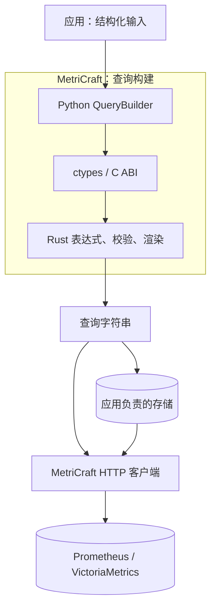

# 架构

<a id="scope-and-repository"></a>

## 范围与仓库

MetriCraft 是查询构建 SDK 和 Prometheus/VictoriaMetrics HTTP 客户端，仅面向 PromQL、MetricsQL。产品不包含 SQL/Flux 抽象、服务器、仪表盘或存储服务。

Rust 与 Python 位于同一仓库，便于在同一个提交中修改 AST、ABI、绑定和测试。



源码对应 `crates/metricraft-core/`、`crates/metricraft-ffi/` 和 `python/metricraft/`；应用集成示例在 `docs/examples/`。

<a id="one-builder-two-modes"></a>

## 一个构建器，两种模式

`metricraft.QueryBuilder` 是唯一的公共构建器。无状态操作模块提供链式方法，`_expression.py` 管理原生句柄，`_native.py` 绑定 ctypes。操作模块依赖原生边界，不依赖 HTTP 客户端。

创建表达式不需要服务器配置。`build("promql")` 和 `build("metricsql")` 返回查询字符串，默认方言为 MetricsQL；保存文本时应显式选择模式。

`@vm_only` 标记 MetricsQL 专有方法，`@prom_only` 标记 PromQL 专有方法；实际约束保存在 Rust 节点上，构建会检查所有嵌套节点。函数签名也携带要求：`rate(selector)` 使用 MetricsQL 隐式范围，而 `rate(selector[5m])` 两种模式都接受。这是同一个方法的不同调用形式。

固定版本的 MetricsQL 解析器不实现 PromQL 的 `histogram_count` 和 `histogram_sum`。这些方法标为 `@prom_only`，在 MetricsQL 模式中被核心拒绝，包括通过通用 `function()` 调用的情况。约束由 Rust 检查，不依赖 Python 装饰器的可信性。

<a id="aggregation-and-grouping"></a>

## 聚合与分组

普通聚合在两种方言中都有效。分组是独立、互斥的操作，而不是每个聚合方法上的两个可选参数：

```python
from metricraft import QueryBuilder as Q

aggregate = Q.from_metric("http_requests_total").rate("5m").sum()
total = aggregate.build("promql")
per_job = aggregate.by("job").build("promql")
per_other_labels = aggregate.without("instance").build("metricsql")
```

不接受 `sum(by=..., without=...)`。聚合一旦分组，再调用 `by()`/`without()` 就会被 Rust 拒绝，包括重复调用同一种方式。需要不同分组时，从未分组表达式分别派生。空 `by()` 按零个标签分组，空 `without()` 不排除任何分组标签，两者不同。参数化聚合使用相同形式，例如 `topk(3).by("job")`。

<a id="functional-core-and-ownership"></a>

## 函数式核心与所有权

核心使用 `Arc` 后面的私有节点。每次转换返回新表达式，共享已有不可变子节点；不修改公共表达式，不使用父链接、可变 AST 注册表或 Python AST 副本。

选择器共享持久化匹配器链与不可变指标名，二元修饰符共享标签列表。源指标通过 `from_metric()` 选定，并在该表达式中保持不变。复用选择逻辑应使用接收不可变应用参数的纯函数。MetricsQL `alias()` 转换的是结果名称，不会修改源选择器。

C ABI 在调用期间借用子指针，并返回拥有所有权的不透明指针。Rust 独立于 Python 对象保留共享子节点。Python finalizer 释放每个所有者，释放中间 Python 表达式不会使其父表达式失效。仅使用客户端的导入不会加载原生库。不安全 C 调用者必须确保指针有效，并对每个返回表达式只释放一次。

验证和渲染位于核心；Python 负责参数适配与便捷方法，ABI 负责字符串、错误和生命周期。没有 Python 渲染器回退。原生库只暴露不可变表达式 ABI。Python 绑定表达式函数前先检查 `mc_abi_version()`，不兼容时提示重新构建或安装。

构造和构建失败使用拥有所有权的线程局部错误快照，可恢复 Rust panic 会在 ABI 边界捕获。这并不意味着无效 C 指针、分配失败或递归栈耗尽可恢复；复杂度和内存压力另行处理。渲染及最后所有者销毁采用迭代遍历，包含持久化匹配器链。

每个节点保存两个大小计数，而不缓存查询文本。`build()` 在分配前检查展开文本大小，默认限制 1 MiB UTF-8 输出和 100,000 次展开节点出现（包含匹配器）。单次调用可用正的 `max_output_bytes`、`max_expanded_nodes` 覆盖。共享子树不会消除其在输出中的重复出现。这不是进程级内存配额，见[内存行为](memory.md)。

<a id="implemented-surface"></a>

## 已实现的能力

固定版本目录、语法和实验功能开关详见[语言支持](language-support.md)。核心主要负责三类操作：

- **选择与时间**：命名或无名选择器、标签匹配、范围、子查询、偏移和时间戳。
- **表达式组合**：算术、比较、集合运算、向量匹配、聚合分组和有类型的函数目录。
- **语言扩展**：方言专有函数、MetricsQL 作用域模板，以及需要显式启用的 Prometheus 实验语法。

链式方法与 `Q.function(name, *args)` 共用 [`functions.rs`](../../crates/metricraft-core/src/expression/functions.rs) 及[标签目录](../../crates/metricraft-core/src/expression/functions/labels.rs) 中的原生签名。字符串始终作为字面量。重复 `.where_*()` 会增加必须同时满足的条件，包括同一标签上的条件，不会替换已有应用约束。

实验开关只作用于当次构建，且要求服务器支持；不会绕过类型或方言校验。独立兼容性流程将发现的能力交给上游解析器与真实后端检查，证据和限制见[后端验证](backend-validation.md)。

回归测试和基准直接验证公共不可变构建器。

<a id="client-and-packaging"></a>

## 客户端与打包

只有一个发行包与命名空间：`metricraft`。`PrometheusConfig`、`VMSingleConfig`、`VMClusterConfig` 选择 HTTP 路由，不选择构建器查询模式。`DatabaseClient(config)` 直接创建具体客户端，无需入口点、插件发现、工厂元类或第二个软件包。

同步与异步查询、范围、元数据、VictoriaMetrics 写入、租户路由和结果模型共用该客户端。建议显式传入配置；多实例应用可以使用[命名注册表](models.md#optional-configuration-registry)。名称有歧义时会在分配传输前失败。`DBType` 标识 HTTP 后端，`QueryMode` 标识查询语言。

`DatabaseClient`、`SyncHTTPClient`、`AsyncHTTPClient` 是没有提供方基类的具体类。通过 `HttpClientOptions` 注入实现所需 `get`/`post` 方法的普通传输对象，也可使用工厂从连接设置创建传输。客户端组合传输所有者以实现幂等清理，不继承生命周期钩子。

同步使用 `with` 或 `close()`；仅异步传输使用 `async with` 或 `aclose()`。垃圾回收只提供尽力而为的同步清理。默认异步包装器借用客户端同步传输，由所有者关闭一次；独立包装器也将外部传输和执行器的所有权留给调用方。

客户端收到 `QueryBuilder` 时，按后端配置选择方言构建，元数据 API 中的选择器同样如此。不支持的 SDK 表达式在 HTTP 请求之前失败。保存的字符串或外部文本生成器保留自己的验证责任，客户端不解析或清理输出。

`MetricsQueryResult` 和 `MetricsInsertData` 是冻结的具体 dataclass。使用具体结果类型及传输注入。配置继承表达三种端点布局，元数据结果子类共享响应解析。

GitHub Actions 将原生库打包到 `metricraft/native/`。C ABI 不使用 CPython 扩展 API，因此 wheel 标签为 `py3-none-<platform>`。发布检查验证源码身份、wheel 完整性与安装后行为。sdist 包含 Python SDK、Rust 源码和 Cargo 锁文件，可独立构建。目标平台与触发方式见[工作流指南](contributing.md#github-actions)。

<a id="performance-and-next-work"></a>

## 性能与后续工作

公共查询验证抛出 `TypeError` 或 `ValueError`，原生加载失败抛出 `RuntimeError`。公共异常包保留 `MetriCraftError` 及 HTTP 子类 `MCHTTPError`、`TimeoutError`、`ConnectionError`。公共枚举包保留 `DBType`。

当前结构避免组合时的 Python AST 遍历与整树复制。[本地微基准](benchmarks.md) 测量当前 Python 外观和纯 Rust 的构建、渲染、释放、复用。统一套件也测量合成可配置监控负载与并发内存，替代无法取得的原始调用轨迹，不代表生产应用或 HTTP 延迟。

HTTP 传输位于 Python 中。当前基线见[语言支持](language-support.md)，软件包验证与发布检查见[贡献指南](contributing.md#github-actions)。
