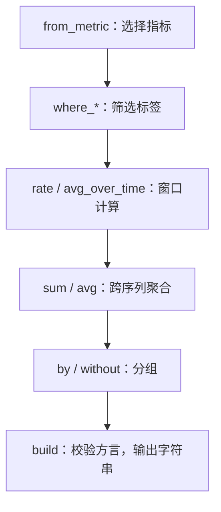

# 构建查询



下面以请求速率为例，按这个顺序组合查询。每一步都返回新表达式。


<a id="start-with-a-value"></a>

## 从一个值开始

```python
from metricraft import QueryBuilder as Q

requests = Q.from_metric("http_requests_total")
selected = requests.where_eq("job", "api").where_regex("status", "5..")
```

工厂方法还可以创建标量（`Q.from_scalar(1)`）、字符串（`Q.from_string("api")`）和无指标名选择器（`Q.from_labels(job="api")`）。没有修改指标名的 setter；选择其他指标时应创建新表达式。

使用 `.where_eq()`、`.where_ne()`、`.where_regex()` 和 `.where_not_regex()` 添加匹配器。值会转义为查询字面量，正则方法则保留正则语义。重复添加的条件按逻辑与组合，不会替换旧条件。

<a id="roll-up-then-aggregate"></a>

## 先计算时间窗口，再聚合

```python
rate = selected.rate("5m")
by_job = rate.sum().by("job")
total = rate.sum()
without_instance = rate.sum().without("instance")
```

PromQL 和 MetricsQL 都支持不带分组的聚合。聚合上的 `.by()` 与 `.without()` 是互斥选项，不能同时使用；原生校验器会拒绝冲突形式。

<a id="compose-arithmetic-and-matching"></a>

## 组合运算与匹配规则

```python
all_requests = requests.rate("5m").sum().by("job")
failures = requests.where_regex("status", "5..").rate("5m").sum().by("job")
fraction = (failures / all_requests).on("job")
text = fraction.build("promql")
```

Python 算术与比较运算符会创建表达式。复杂组合应显式加括号。Python 的 `and`、`or`、`if expression` 会要求一个真假值，不能表示查询操作；集合运算使用 `.and_()` / `.or_()`。向量匹配使用 `.on()` 或 `.ignoring()`，并在语言允许时使用 `.group_left()` / `.group_right()`。

<a id="use-the-function-catalog"></a>

## 使用函数目录

链式方法覆盖函数目录，也可以通过通用入口显式调用函数：

```python
rounded = Q.function("round", Q.from_metric("temperature_celsius"), 0.1)
text = rounded.build("promql")
```

参数始终是有类型的值。`Q.function("rate", "requests[5m]")` 不会把字符串解析成表达式，应使用 `requests.rate("5m")`，或传入一个范围表达式。链式方法和通用调用都使用 Rust 的函数签名目录。

<a id="render-within-a-budget"></a>

## 在预算内渲染

```python
text = by_job.build("promql", max_output_bytes=64_000, max_expanded_nodes=10_000)
```

默认上限是 1 MiB 输出与 100,000 次展开节点出现。共享节点每次出现在输出中都会计数。这些限制约束渲染，不限制应用保留的根节点、服务器查询成本或服务器端模板展开。

子查询、偏移、具有作用域的 MetricsQL 模板及 Prometheus 实验语法，见[语言支持](language-support.md)和[扩展示例](examples/03_language_extensions/README.md)。
