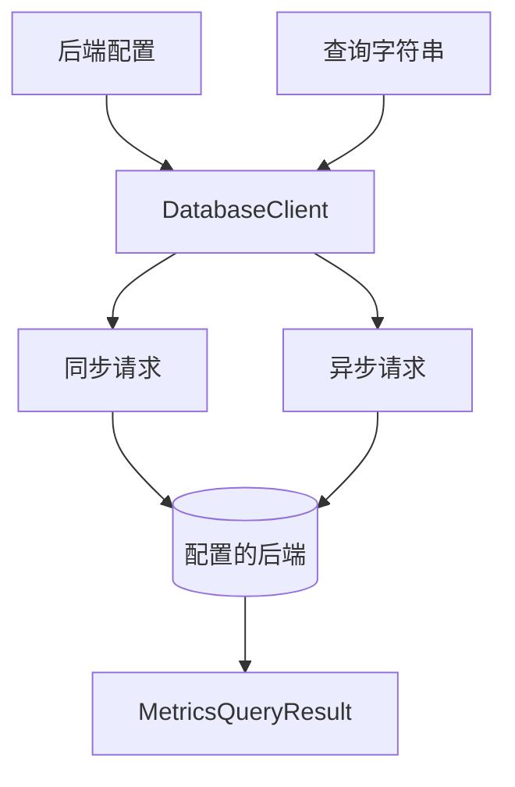

# 查询后端

`DatabaseClient` 提供同步与异步 HTTP 调用。执行已保存的查询字符串时，不需要加载 Rust 构建器库。



<a id="choose-an-endpoint"></a>

## 选择端点

```python
from metricraft import (
    DatabaseClient, HttpClientOptions, PrometheusConfig,
    VMSingleConfig, VMClusterConfig,
)

prometheus = PrometheusConfig("http://localhost:9090")
single = VMSingleConfig("http://localhost:8428")
cluster = VMClusterConfig(
    vminsert_url="http://localhost:8480",
    vmselect_url="http://localhost:8481",
    vmstorage_url="http://localhost:8482",
    account_id=0,
)
```

集群配置会为查询与写入端点添加租户路径前缀。请求级 `account_id` 覆盖只适用于 `VMClusterConfig`。Prometheus 不支持客户端的 VictoriaMetrics 写入 API。

<a id="instant-and-range-queries"></a>

## 即时查询与范围查询

```python
with DatabaseClient(prometheus) as client:
    instant = client.query("up")
    history = client.query_range(
        "up",
        start="2026-01-01T00:00:00Z",
        end="2026-01-01T01:00:00Z",
        step="1m",
    )
    print(instant.is_success, history.is_success)
```

这些示例需要运行中的服务器。范围查询的结果取决于请求时间段内的数据。复现事件或对比结果时，建议显式设置起止时间。查询时间支持 Unix 时间戳和 RFC3339 字符串；VictoriaMetrics 还支持相对时间字符串。

<a id="asynchronous-calls"></a>

## 异步调用

```python
import asyncio
from metricraft import DatabaseClient, PrometheusConfig

async def read():
    async with DatabaseClient(PrometheusConfig("http://localhost:9090")) as client:
        result = await client.query_async("up")
        print(result.is_success)

asyncio.run(read())
```

范围查询使用 `.query_range_async()`。异步上下文管理器会等待传输资源清理；如果自行管理生命周期，应调用 `await client.aclose()`。

<a id="configure-transport-behavior"></a>

## 配置传输行为

```python
options = HttpClientOptions(timeout=(5.0, 30.0))
config = PrometheusConfig("http://localhost:9090", http_options=options)
```

元组分别指定连接超时和读取超时，单位为秒。查询方法中的 `timeout="30s"` 则是独立的服务器查询超时。`HttpClientOptions` 也支持请求头以及注入同步、异步传输。凭据应保存在应用的机密配置中，不应写入持久化查询文本。

<a id="handle-results-and-failures"></a>

## 处理结果与失败

`MetricsQueryResult` 提供 `is_success`、结果类型、数据和服务器错误。传输失败使用 SDK 的 `MCHTTPError`、`TimeoutError`、`ConnectionError`，均可从 `metricraft` 导入。

元数据方法包括 `series()`、`labels()`、`label_values()`，也都有异步版本。

客户端会发送传入的字符串，不解析或清理已保存的查询。授权、输入校验和存储由应用负责。不需要服务器的可运行示例见[先保存，再查询](examples/02_saved_query/README.md)。
