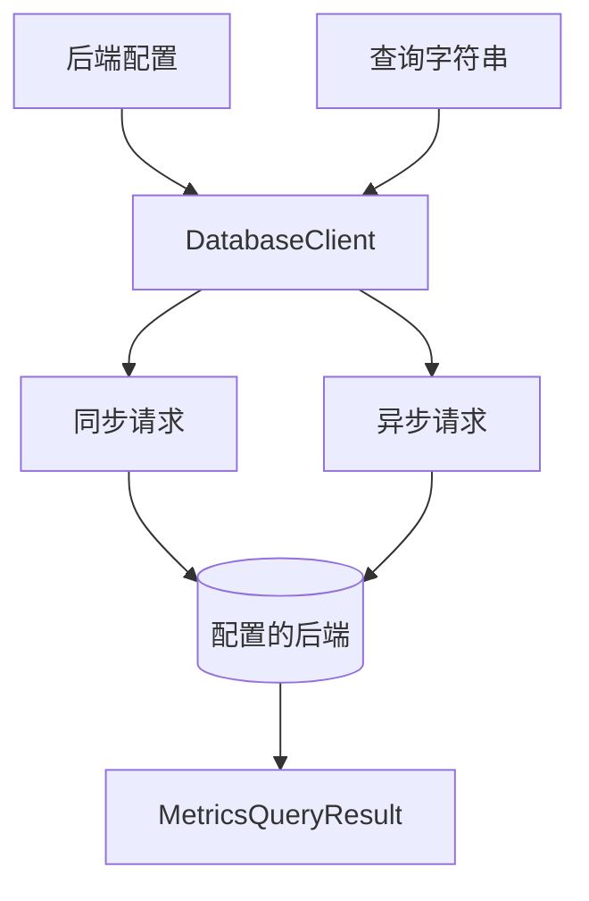
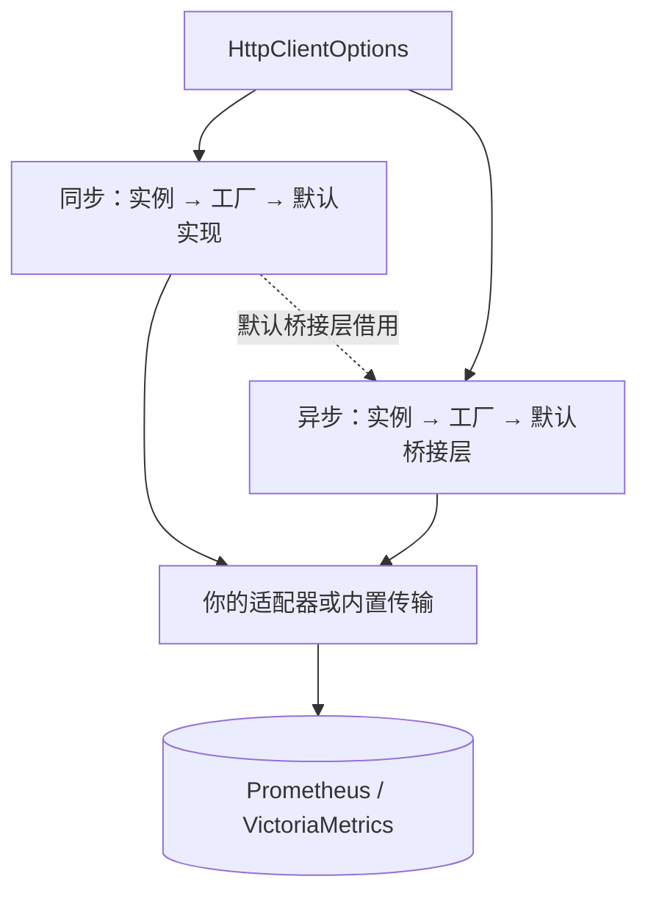

# 查询后端

`DatabaseClient` 提供同步与异步 HTTP 调用。执行已保存的查询字符串时，不需要加载 Rust 构建器库。



<a id="choose-an-endpoint"></a>

## 选择端点

```python
from metricraft import (
    DatabaseClient, HttpClientOptions, PrometheusConfig,
    VMSingleConfig, VMClusterConfig,
)

prometheus = PrometheusConfig("http://localhost:9090")
single = VMSingleConfig("http://localhost:8428")
cluster = VMClusterConfig(
    vminsert_url="http://localhost:8480",
    vmselect_url="http://localhost:8481",
    vmstorage_url="http://localhost:8482",
    account_id=0,
)
```

集群配置会为查询与写入端点添加租户路径前缀。请求级 `account_id` 覆盖只适用于 `VMClusterConfig`。Prometheus 不支持客户端的 VictoriaMetrics 写入 API。

<a id="instant-and-range-queries"></a>

## 即时查询与范围查询

```python
with DatabaseClient(prometheus) as client:
    instant = client.query("up")
    history = client.query_range(
        "up",
        start="2026-01-01T00:00:00Z",
        end="2026-01-01T01:00:00Z",
        step="1m",
    )
    print(instant.is_success, history.is_success)
```

这些示例需要运行中的服务器。范围查询的结果取决于请求时间段内的数据。复现事件或对比结果时，建议显式设置起止时间。查询时间支持 Unix 时间戳和 RFC3339 字符串；VictoriaMetrics 还支持相对时间字符串。

<a id="asynchronous-calls"></a>

## 异步调用

```python
import asyncio
from metricraft import DatabaseClient, PrometheusConfig

async def read():
    async with DatabaseClient(PrometheusConfig("http://localhost:9090")) as client:
        result = await client.query_async("up")
        print(result.is_success)

asyncio.run(read())
```

范围查询使用 `.query_range_async()`。异步上下文管理器会等待传输资源清理；如果自行管理生命周期，应调用 `await client.aclose()`。

<a id="configure-transport-behavior"></a>

## 配置传输行为

```python
options = HttpClientOptions(timeout=(5.0, 30.0))
config = PrometheusConfig("http://localhost:9090", http_options=options)
```

元组分别指定连接超时和读取超时，单位为秒。查询方法中的 `timeout="30s"` 则是独立的服务器查询超时。`HttpClientOptions` 也支持请求头以及注入同步、异步传输。凭据应保存在应用的机密配置中，不应写入持久化查询文本。

<a id="replace-the-http-transport"></a>

## 替换 HTTP 传输

HTTP 层是公开扩展点。你可以将应用已有的连接池、认证、链路追踪或重试逻辑包装成适配器，通过 `HttpClientOptions` 注入。四个公开契约都可从 `metricraft` 导入：

| 插槽 | 公开契约 | 选择规则 |
| --- | --- | --- |
| `client` | `SyncHTTPTransport` | 同步调用使用这个实例。 |
| `async_client` | `AsyncHTTPTransport` | 异步调用使用这个实例。 |
| `client_factory` | `SyncHTTPTransportFactory` | 未提供 `client` 时，调用工厂创建同步传输。 |
| `async_client_factory` | `AsyncHTTPTransportFactory` | 未提供 `async_client` 时，调用工厂创建异步传输。 |



<a id="implement-an-adapter"></a>

### 实现适配器

契约使用结构化 `Protocol`，不要求继承或注册。两种传输都提供下列签名的 `get()` 和 `post()`；异步适配器将两者写成 `async def`。类型检查器会校验参数名称和解析后的 `HTTPResponse` 字典返回值。嵌套 JSON 值的类型是 `object`，访问前应先缩小类型。下面包装内置传输；接入自己的 HTTP 库时，保持接口一致，替换内部实现即可。

```python
from typing import Optional
from metricraft import DatabaseClient, HttpClientOptions, PrometheusConfig, SyncHTTPTransport
from metricraft.client import SyncHTTPClient
from metricraft.transports import HTTPBody, HTTPHeaders, HTTPParams, HTTPResponse, HTTPTimeout

class AppTransport:
    def __init__(self, inner: SyncHTTPClient):
        self.inner = inner

    def get(self, url: str, params: Optional[HTTPParams] = None, *,
            headers: Optional[HTTPHeaders] = None,
            timeout: Optional[HTTPTimeout] = None) -> HTTPResponse:
        return self.inner.get(url, params, headers=headers, timeout=timeout)

    def post(self, url: str, data: HTTPBody = None,
             params: Optional[HTTPParams] = None, *,
             headers: Optional[HTTPHeaders] = None,
             timeout: Optional[HTTPTimeout] = None,
             content_type: Optional[str] = None) -> HTTPResponse:
        return self.inner.post(url, data, params, headers=headers,
                               timeout=timeout, content_type=content_type)

    def get_text(self, url: str) -> str:
        return self.inner.get_text(url)

    def close(self) -> None:
        self.inner.close()

transport: SyncHTTPTransport = AppTransport(SyncHTTPClient(timeout=(5, 30)))
config = PrometheusConfig(
    "http://localhost:9090", http_options=HttpClientOptions(client=transport),
)
with DatabaseClient(config) as client:
    result = client.query("up")
```

查询需要运行中的服务器。适配器应返回后端 JSON 解析得到的字典，不能直接返回 requests/httpx 的 Response 对象。写入时，`post()` 还需接受文本或 bytes 请求体。如果希望应用沿用内置传输的异常处理方式，应将传输错误转换为 `metricraft` 中的 `MCHTTPError`、`TimeoutError` 或 `ConnectionError`。

`get_text(url) -> str` 是可选能力，用于纯文本健康检查端点；没有它时，健康检查回退到 `get()`。通用 `request()` 方法也是可选的：默认异步桥接层优先调用它，否则分别调用 `get()` 和 `post()`。即使应用目前只查询，也建议实现完整签名，以兼容写入和异步桥接。

<a id="construct-transports-with-factories"></a>

### 使用工厂创建传输

工厂在构造 `DatabaseClient` 时执行。两个工厂都通过关键字接收 `http_options`（规范化后的选项）和 `connection_info`（后端连接配置）。异步工厂还会收到已选定的 `sync_client`；工厂本身是普通函数，返回异步传输对象，不是协程工厂。沿用上面的适配器：

```python
from typing import Mapping
from metricraft import AsyncHTTPTransport, SyncHTTPTransport
from metricraft.client import AsyncHTTPClient

def make_sync(*, http_options: Mapping[str, object],
              connection_info: Mapping[str, object]) -> SyncHTTPTransport:
    settings = HttpClientOptions.from_mapping(http_options)
    return AppTransport(SyncHTTPClient(
        timeout=settings.timeout, default_headers=settings.default_headers,
    ))

def make_async(*, http_options: Mapping[str, object],
               connection_info: Mapping[str, object],
               sync_client: SyncHTTPTransport) -> AsyncHTTPTransport:
    return AsyncHTTPClient(sync_client=sync_client)

options = HttpClientOptions(
    timeout=(5, 30), default_headers={"X-Application": "dashboard"},
    client_factory=make_sync, async_client_factory=make_async,
)
config = PrometheusConfig("http://localhost:9090", http_options=options)
```

将 `config` 传给 `DatabaseClient` 后，照常使用 `query()` 或 `await query_async()`。未指定异步实例或工厂时，SDK 通过线程池桥接选定的同步传输；需要原生异步 I/O 时，提供 `async_client` 或 `async_client_factory`。

注入的传输自行管理 HTTP 策略：已有实例不会自动套用配置中的请求头、超时、认证和重试逻辑。工厂可以读取配置并显式应用这些设置。

<a id="own-transport-lifetime"></a>

### 管理传输生命周期

`DatabaseClient` 负责清理选定的传输，包括注入的实例。同步传输可提供 `close()`；异步传输可提供 `aclose()`、`close()` 或两者。`with` 执行同步清理；`async with` 优先等待 `aclose()`，然后关闭同步传输。需要异步清理的适配器必须使用 `async with` 或 `await client.aclose()`。

内置异步桥接层借用同步传输和外部执行器，不会关闭借用的资源；所属的 `DatabaseClient` 负责关闭同步传输。如果适配器包装应用共享的连接池，应让适配器的清理钩子保留该池，由应用统一关闭。关闭前先等待未完成请求结束。共享的适配器需要支持并发调用，包括自由线程 Python 和默认异步桥接场景。

<a id="handle-results-and-failures"></a>

## 处理结果与失败

`MetricsQueryResult` 提供 `is_success`、结果类型、数据和服务器错误。传输失败使用 SDK 的 `MCHTTPError`、`TimeoutError`、`ConnectionError`，均可从 `metricraft` 导入。

元数据方法包括 `series()`、`labels()`、`label_values()`，也都有异步版本。

客户端会发送传入的字符串，不解析或清理已保存的查询。授权、输入校验和存储由应用负责。不需要服务器的可运行示例见[先保存，再查询](examples/02_saved_query/README.md)。
