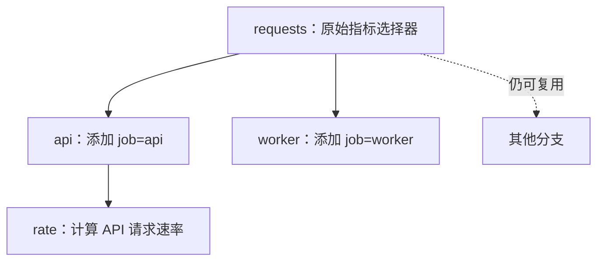

# 核心概念

<a id="expressions-are-values"></a>

## 表达式是值

表达式描述一条查询。创建或组合表达式不会访问服务器。每次操作都返回一个新值，后续操作不会重命名、修改或消耗原有表达式。

```python
from metricraft import QueryBuilder as Q

requests = Q.from_metric("http_requests_total")
api = requests.where_eq("job", "api")
worker = requests.where_eq("job", "worker")
```



Rust 节点通过引用计数共享不可变子表达式，派生分支不会深拷贝整棵树。但保留大量不同的根表达式仍然会占用内存：共享减少重复，并不会限制应用保存的查询数量。参见[共享与内存](memory.md)。

<a id="build-chooses-the-dialect"></a>

## 构建时选择方言

只有一个 `QueryBuilder`。`.build("promql")` 与 `.build("metricsql")` 会根据所选语言验证整个表达式，再渲染成字符串。仅适用于 MetricsQL 的形式在构建为 PromQL 时会失败；仅适用于 PromQL 的形式在构建为 MetricsQL 时也会失败。API 参考会同时标注 `vm_only` 与 `prom_only` 方法。Prometheus 实验功能需要显式构建开关，服务器也要启用对应功能。

默认构建方言是 MetricsQL。同一个表达式能在两种语言中构建，并不意味着两个服务器会得到相同数值。准确的基线和限制见[语言支持](language-support.md)。

<a id="strings-are-data-during-construction"></a>

## 构建过程中的字符串是数据

将标签值传给 `.where_eq()` 等方法，构建器会把它转义为字面量。表达式参数应传入真正的表达式；传给 `Q.function()` 的字符串是字符串字面量，绝不会作为查询片段嵌入。

应用仍然需要决定用户可以请求哪些指标、标签、操作和正则表达式。语法安全的查询也可能计算成本很高，或访问用户不应看到的数据。

<a id="persistence-belongs-to-your-application"></a>

## 持久化由应用负责

`.build()` 输出普通字符串。应用可以使用相应格式的标准序列化器，将它保存到数据库、YAML、XML 或其他存储中，之后读取并交给 `DatabaseClient`。

MetriCraft 不保存查询，不验证任意已保存的查询文本，也不提供访问控制。构建器保证结构化构建的规则，客户端执行传入的文本。[保存查询示例](examples/02_saved_query/README.md) 使用 SQLite 和离线传输展示了这个边界。

<a id="evaluation-belongs-to-the-backend"></a>

## 求值由后端负责

MetriCraft 构建查询语法并处理 HTTP 请求，不执行查询求值，也不实现时序数据库。数据保留、陈旧标记、查询成本和数值行为由后端服务器决定。
