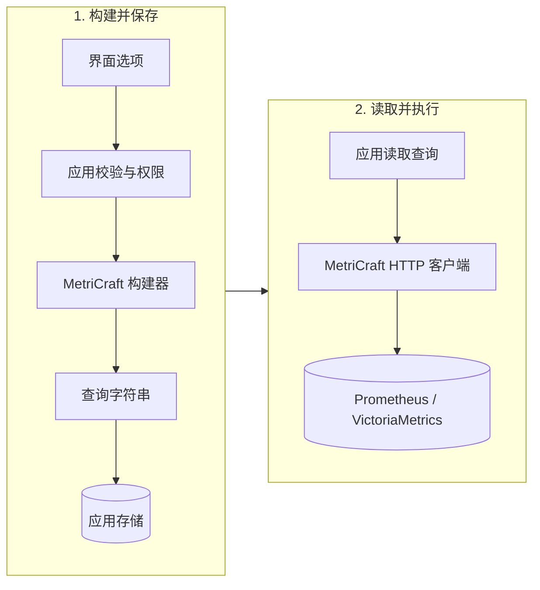

# 可配置查询的职责边界

把用户选项转换成查询，再按应用自己的方式保存和执行。构建阶段不需要数据库连接，执行阶段只需要查询文本。

构建器只生成查询字符串；保存与读取由应用负责，查询求值由后端负责。两个阶段可以分开运行。

- **应用负责**：允许的指标、标签、操作、权限和成本限制，以及 YAML/XML/数据库中的保存与读取。选项变化时，从合适的基础表达式重新派生。
- **构建器负责**：验证表达式结构、名称、时长与函数目录；转义标签值和字符串参数。重复匹配器按逻辑与组合，不会覆盖已有租户等约束。正则仍有正则语义，其成本由应用与后端负责。
- **客户端负责**：将查询交给后端，提供同步/异步查询、元数据、写入、自定义传输、结果模型和集群路由。先按目标方言构建并保存文本；读取后执行时，不会重新选择方言或验证文本。

构建保证只适用于结构化输入。构建器没有原始表达式插入口；客户端不会解析、清理或修复任意查询字符串。保存后的编辑、完整性和授权由应用负责。

参见[结构化选项示例](examples/01_configurable_query/README.md)和[保存查询示例](examples/02_saved_query/README.md)。
