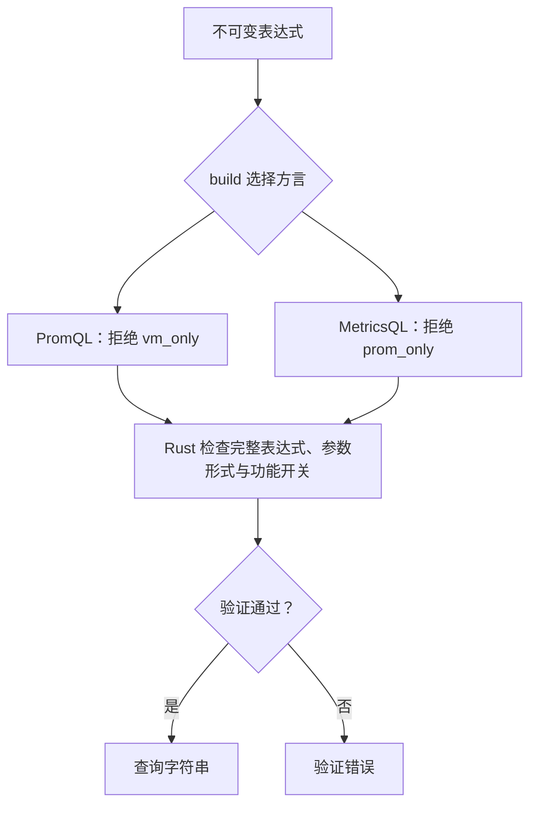

# 语言支持

稳定基线为 Prometheus **3.15.0**、VictoriaMetrics **1.153.0**，后者的 MetricsQL 解析器依赖为 **v0.87.4**。目录覆盖该基线全部 90 个 PromQL 函数和 14 个聚合，以及文档列出的全部 195 个 MetricsQL 函数和 37 个聚合。链式方法与 `Q.function(name, *args)` 共用原生签名校验。

方言支持会双向检查。API 参考用 `vm_only` 标注 MetricsQL 专有方法，用 `prom_only` 标注 PromQL 专有方法。例如，该基线中的 `histogram_count()`、`histogram_sum()` 要求 PromQL，在 MetricsQL 中会被拒绝，通过 `Q.function()` 调用或嵌套使用也一样。部分共享方法还存在方言专有的参数形式，因此没有专有标记并不保证所有调用形式都支持两种语言。

这是查询构建器与 HTTP 客户端，不是查询求值器或源码解析器。后端计算、存储、陈旧数据处理和原生直方图数据处理由所选服务器负责。现成的查询字符串直接交给客户端。数字与时长输入会规范化，生成文本不包含注释或尾随逗号，也没有插入原始表达式的 API。



<a id="construction"></a>

## 构建能力

- 选择器支持 UTF-8 指标名和标签名、转义值、重复且按逻辑与组合的过滤器、无指标名选择器及仅含正则的选择器。PromQL 要求选择器具有指标名，或者至少有一个排除空标签值的过滤器。MetricsQL 允许空选择器和 `or_selector()` 分支。名称必须非空且不包含控制字符；正则值保留 RE2 语义。
- 算术、比较、集合运算、`.bool()`、`.on()` / `.ignoring()`、`.group_left()` / `.group_right()`、范围、子查询、偏移和时间戳均为结构化操作。聚合分组中的 `.by()` 与 `.without()` 互斥。
- MetricsQL 另外支持标量、向量与范围的隐式转换，可变参数聚合，小数或区间相关时长，表达式时间戳，`.eq_any()` / `.ne_all()`、`.group_left_all(prefix=...)`、`.group_right_all(prefix=...)`、`.limit()`、`default` / `if` / `ifnot` 和 `.keep_metric_names()`。
- `Q.from_duration("1h30m")` 创建以秒为单位的标量；`Q.from_duration("2i")` 使用查询时的 `step()`；`Q.from_numeric_literal("1_000Ki")` 规范化数字后缀。
- MetricsQL 的 `Q.reference()`、`Q.template()`、`Q.template_call()` 和 `.with_()` 提供词法绑定。定义可以看到更早的绑定，参数和内层作用域会遮蔽外层同名值。引用在构建时检查。字符串引用使用 `kind="string"`，可以用 `+` 组合经过转义的选择器值。

每次派生都返回共享 Rust 节点的新表达式。没有修改源指标名的 setter、可变 AST、全局符号注册表或 Python 树遍历。

<a id="prometheus-feature-flags"></a>

## Prometheus 功能开关

实验函数需要 `experimental_functions=True`。实验语法需要在 `features` 中列出功能名称，服务器也必须启用相同功能：

```python
from metricraft import QueryBuilder as Q

a, b = Q.from_metric("a"), Q.from_metric("b")
text = (a + b).fill(0).build(
    "promql", features=("promql-binop-fill-modifiers",))

text = a.range(Q.step().max_of(60) * 2).rate().build(
    "promql", features=("promql-duration-expr",))

text = a.range("5m").anchored().rate().build(
    "promql", features=("promql-extended-range-selectors",))
```

时长表达式允许数字、算术、`step()`、`range()`（对应 `Q.query_range()` 工厂）、`min_of()` 和 `max_of()`。即时查询中的 step/range 为零，因此应指定正的下界，或者执行范围查询。

anchored 范围接受 `rate`、`increase`、`delta`、`changes`、`resets`；smoothed 范围接受 `rate`、`increase`、`delta`。Prometheus 还支持 smoothed 即时选择器及直方图 `.trim_lower()` / `.trim_upper()`。

`.histogram_quantiles(label, *quantiles)` 在构建时选择参数顺序：PromQL 的向量在前，MetricsQL 的向量在后。PromQL 需要实验函数开关，并最多接受十个分位数。通用 `function()` 形式遵循各上游的参数顺序。

实验查询应先显式构建成字符串，再传给客户端。功能开关只作用于一次构建，不会放宽方言或结构校验。

<a id="verification-and-version-policy"></a>

## 验证与版本策略

兼容性 Action 会发现官方函数目录和文档主题，构建有代表性的签名与语法，并交给上游解析器检查；随后向两个真实后端发送生成的调用，检查即时与范围请求是否被接受。另有独立测试数据验证预期数值、标签和时间戳。名称缺失、签名差异、未覆盖主题和被拒绝的探针都会导致检查失败。

报告、上游快照和哈希作为 Actions 产物生成，不进入库或单元测试套件。上游主线尚未发布的新函数保留为 `upstream_ahead`；目前包括 Prometheus 的 `integral`，它不在 3.15.0 中。升级基线时必须同时增加实现与执行样例。样例通过不代表支持所有可能的表达式，也不证明 PromQL 与 MetricsQL 数值等价。

构建限制约束输出字节与 AST 展开次数，不限制应用仍持有的根节点、后端成本或服务器对 WITH 模板的展开。参见[内存](memory.md)、[后端验证](backend-validation.md)和[可运行示例](examples/03_language_extensions/README.md)。
