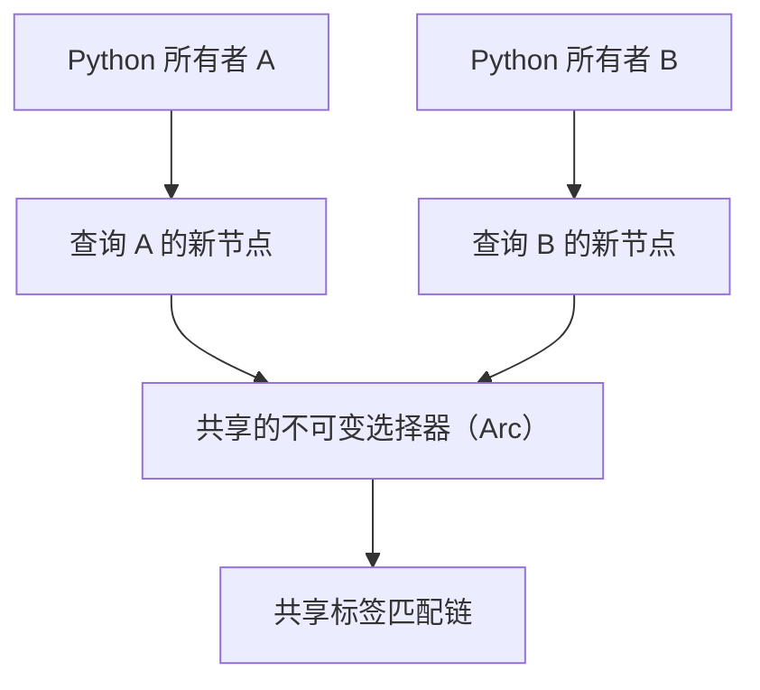

# 不可变表达式与内存



派生表达式只增加所需节点，不深拷贝整棵树。每个新根节点、字面量和 Python 所有者仍有成本。

保留一个根节点就会保留它可达的子节点。只有最后一个所有者释放后，共享数据才会销毁；这是 [Arc 的所有权规则](https://doc.rust-lang.org/std/sync/struct.Arc.html)。保留大量查询属于应用状态，不自动意味着泄漏。

<a id="query-construction-contract"></a>

## 查询构建约定

通过 `Q.from_metric(name)` 一次选定源指标。没有 `.metric()` setter/替换方法，也没有原生 `rename_metric` 操作。将选择规则作为不可变数据，通过纯应用函数复用：

```python
from metricraft import QueryBuilder as Q

filters = (("job", "api"), ("env", "prod"))

def select(name, filters):
    query = Q.from_metric(name)
    for label, value in filters:
        query = query.where_eq(label, value)
    return query

requests = select("http_requests_total", filters)
errors = select("http_errors_total", filters)
rate = requests.rate("5m")  # requests is unchanged
```

这样创建的不同指标各自拥有选择器，不承诺独立构建查询之间存在隐式驻留共享。从同一个表达式派生时，则会共享相应子节点和选择器数据。

<a id="expansion-limits-and-deep-trees"></a>

## 展开限制与深树

很小的共享 DAG 也可能生成巨大文本：不断组合 `q + q`，每次只增加一个二元节点，却使输出翻倍。因此每个节点缓存会饱和的输出字节计数与展开节点计数，不保存渲染文本。`build()` 在预留输出缓冲区前检查这些计数。

默认限制为 1 MiB UTF-8 输出和 100,000 次展开节点出现，包含匹配器。针对已知负载，可以在单次构建中覆盖预算：

```python
text = rate.build("promql", max_output_bytes=2 * 1024 * 1024,
                  max_expanded_nodes=200_000)
```

这些限制不约束存活 Python 表达式的数量或进程总内存。原生渲染与最后所有者释放都采用迭代方式。销毁只拆解生命周期已结束且唯一持有的节点，不会修改任何仍被共享的查询。测试在 256 KiB 线程栈上构建、渲染并释放深度 100,000 的函数链和匹配器链，也覆盖并发最后所有者与展开计数溢出。

<a id="measurements-on-2026-10-08"></a>

## 2026-10-08 的测量

统一套件使用 release 构建，保持验证与垃圾回收开启，报告保存源码和二进制哈希。这些合成负载替代无法取得的应用调用轨迹，不代表生产延迟。

只读图诊断访问唯一节点和匹配器链接，不创建 Python AST。渲染位置诊断展开每次出现，并使用相同原生构建限制，见[诊断参考](reference/diagnostics.md)。

原生分配探针从 256 个标签、每个值 128 字节的选择器开始。计数包含请求的原生分配量和保留根节点容器，不包括分配器开销、Python 堆或操作系统 RSS。Windows GNU release 测量如下：

| 负载 | 保留的原生字节 | 释放后高于基线的字节 |
| --- | ---: | ---: |
| 从一个选择器派生 512 个分支 | 179,900 | 0 |
| 独立构建 512 个带等价过滤条件的选择器 | 30,620,050 | 0 |
| 从一个选择器派生 1,000 个分支 | 294,580 | 0 |
| 从一个选择器派生 10,000 个分支 | 2,418,580 | 0 |
| 10,000 个共享源表达式的 label-copy 分支 | 1,679,943 | 0 |
| 10,000 个共享绑定的 WITH 分支 | 2,629,932 | 0 |
| 保留 1,000 个选择器版本 | 235,234 | 0 |
| 保留基础表达式，执行 10,000 次创建、构建、释放 | 7,566 | 0 |
| 深度 100,000 的函数链 | 13,100,152 | 0 |
| 深度 100,000 的 WITH 链 | 24,900,393 | 0 |
| 60 次共享自组合，在渲染前拒绝 | 7,412 | 0 |
| 共享 DAG 的 1,000 次有界图快照 | 14,826 | 0 |
| 带公共过滤器的 256 次选择器 OR 自组合，在渲染前拒绝 | 94,752 | 0 |

全部十三个场景释放后均回到原生分配基线。结构共享显著减少保留数据，但每个新根节点和操作仍有内存成本。默认预算在渲染前拒绝深 WITH 链的展开文本，最后所有者释放仍采用迭代过程。SDK 输出 WITH 绑定而不展开它，因此构建预算不约束后端的宏展开工作。

选择器 OR 分支与公共过滤条件也保持共享节点。曾有模糊测试超时暴露了提前展开分支列表的问题，失败输入现已成为回归用例。组合和添加过滤器不会枚举分支；渲染器在检查缓存展开预算后才迭代分发过滤器，包含嵌套 OR 分支与计算得到的字符串值。

一次 Python 3.13/Windows 测量每批保留、渲染、释放 2,000 个分支，对选择器、label-copy、WITH 各做十批，共 60,000 个所有者。所有被采样所有者最终均不可达。选择器批次后的 Python 活跃跟踪内存为 75,417–79,235 字节，WITH 批次后为 157,766–161,153 字节，包含不断累积的测量记录。WITH 批次后的进程私有内存约 23.5–25.1 MiB。分配器高水位占用与仍可达查询数据是不同概念。

四工作线程的 Python/ctypes 测量在 60.1 秒内释放 83,456 个查询所有者，并处理 93,888 次预期验证或预算失败。每批检查所有者弱引用和共享基础表达式未变化。批次后进程私有内存约 21.3–22.4 MiB，释放工作线程和基础表达式后为 21.6 MiB，预热后为 20.6 MiB。Python 活跃跟踪内存最终为 42,778 字节，包含测量记录。这次有界运行没有发现持续增长的查询保留状态，但不构成整个应用的内存保证。

Linux ASan 与泄漏检测通过了当前实现的全部 26 项 Rust 测试及十三种原生分配场景，包括小栈和并发最后所有者释放。后续 libFuzzer 使用早期语料和选择器 OR 超时输入作为种子，在 181 秒内完成 100,950 个输入，没有失败。该超时输入也会在普通 Rust 回归套件中确定性地执行。

复现命令见[基准指南](benchmarks.md#memory)。基准 Action 记录完整并发内存曲线。原生分配检查、弱引用断言、sanitizer 和模糊测试提供不同证据，任何单项都不能证明所有负载或任意 FFI 误用安全。
